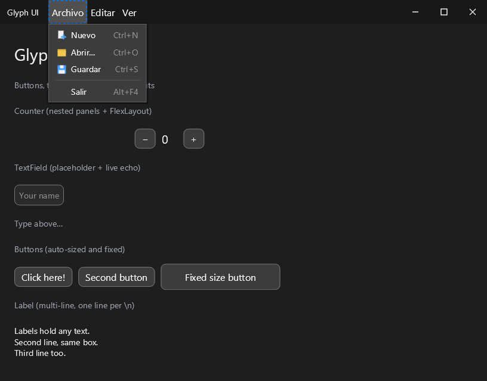

# Glyph UI

A modern UI toolkit built on Skija and JWM for Java 17+.



## Features

- Modern rendering engine powered by Skija (Skia for Java)
- Window management and event handling via JWM (io.github.humbleui:jwm)
- Component-based UI architecture
- Support for rounded corners, custom colors, and text rendering
- Event system for mouse and keyboard input
- Layout managers for automatic component positioning
- Cross-platform support (Windows, Linux, macOS)

## Requirements

- Java 17 or higher
- Maven 3.6+
- OpenGL 3.3+ compatible graphics card

## Platform-Specific Setup

### macOS

On macOS, you need to add the `-XstartOnFirstThread` JVM argument:

```bash
cd glyph-ui-examples && mvn exec:java -Dexec.vmArgs="-XstartOnFirstThread"
```

Or configure your IDE to include this VM argument when running the application.

## Building

```bash
mvn clean compile
```

## Running the examples

Runnable demos live in the separate [`glyph-ui-examples`](glyph-ui-examples)
Maven project, which depends on the toolkit jar. Install the library locally
first, then run any example from the examples directory:

```bash
mvn install -DskipTests          # from the repository root (installs glyph-ui)
cd glyph-ui-examples
mvn exec:java                    # runs io.github.yasmramos.glyphui.examples.App
```

On macOS:
```bash
mvn exec:java -Dexec.vmArgs="-XstartOnFirstThread"
```

### Window backend

JWM (`io.github.humbleui:jwm`) is the single supported window backend. The
former GLFW/LWJGL backend and the runtime backend-selection factory were
removed; `Window` instantiates `JwmWindowBackend` directly. The public
`WindowBackend` interface stays in place as the stable seam between the
toolkit and the native layer.

JWM owns the process UI thread: its native message loop is started by
`Application.run()` (through `WindowBackend.enterEventLoop`), not by
`Application.init()`, which stays fully headless until then. Frames are
blitted from the CPU surface onto the window layer via
`WindowBackend.present(...)`.

## Project Structure

```
src/main/java/io/github/yasmramos/glyphui/
├── core/
│   ├── Application.java      # Main application class with event loop
│   └── Window.java           # Window abstraction using JWM
├── graphics/
│   └── Canvas.java           # Skija drawing wrapper
├── ui/
│   ├── Component.java        # Base class for all UI components
│   ├── Panel.java            # Container for components
│   ├── Button.java           # Clickable button component
│   ├── Label.java            # Text label component
│   ├── CheckBox.java         # Boolean check box
│   ├── RadioButton.java      # Mutually-exclusive choice (with RadioGroup)
│   ├── ToggleSwitch.java     # On/off switch
│   ├── Slider.java           # Continuous value selector
│   ├── Spinner.java          # Numeric stepper with -/+ buttons
│   ├── Badge.java            # Compact pill-shaped label
│   ├── Card.java             # Titled surface grouping content
│   ├── Tabs.java             # Tabbed container, one page at a time
│   ├── Alert.java            # Inline status message with a severity level
│   ├── Avatar.java           # Circular initials or profile image
│   ├── Accordion.java        # Stack of collapsible sections
│   ├── Chip.java             # Compact interactive tag/filter
│   ├── Breadcrumb.java       # Navigation trail of clickable segments
│   ├── Pagination.java       # Pager over a page-split result set
│   ├── Link.java             # Text hyperlink with a visited state
│   ├── Rating.java           # Star rating control
│   ├── Skeleton.java         # Loading placeholder block
│   ├── Stepper.java          # Multi-step flow indicator
│   ├── Toolbar.java          # Horizontal strip of controls
│   ├── GroupBox.java         # Titled border grouping controls
│   ├── ListBox.java          # Scrollable selectable item list
│   ├── Table.java            # Grid of columns and selectable rows
│   ├── TreeView.java         # Hierarchical list of expandable nodes
│   ├── Dialog.java           # Modal surface with a title and actions
│   ├── ColorPicker.java      # Swatch grid color chooser
│   ├── SplitPane.java        # Two panes with a draggable divider
│   ├── ProgressBar.java      # Determinate/indeterminate progress indicator
│   ├── ProgressRing.java     # Circular determinate/indeterminate indicator
│   ├── RangeSlider.java      # Two-thumb slider selecting a range
│   ├── SegmentedControl.java # Row of mutually exclusive options
│   ├── ToggleButton.java     # Button that latches on and off
│   ├── Tooltip.java          # Hover bubble describing a component
│   ├── Toast.java            # Transient notification, hosted by ToastHost
│   ├── MenuBar.java          # Horizontal strip of drop-down menus
│   ├── ContextMenu.java      # Menu opened at an arbitrary point
│   ├── StatusBar.java        # Thin information strip along a window edge
│   ├── Dropdown.java         # Single-choice drop-down list (popup via Menu)
│   ├── TextField.java        # Editable single-line text input
│   ├── ScrollPane.java       # Scrollable container
│   ├── Separator.java        # One-pixel divider
│   └── ComponentState.java   # Component state enum
├── events/
│   ├── MouseEvent.java       # Mouse event class
│   ├── KeyEvent.java         # Key event class
│   ├── MouseEventType.java   # Mouse event type enum
│   ├── MouseButton.java      # Mouse button enum
│   ├── KeyEventType.java     # Key event type enum
│   └── KeyModifier.java      # Key modifier enum
├── markup/
│   ├── Tokenizer.java        # .glyph lexer (three-mode scanner)
│   ├── Parser.java           # .glyph recursive-descent parser -> AST
│   └── UiLoader.java         # AST -> widget tree mapper
└── layout/
    ├── LayoutManager.java    # Base class for layout managers
    └── FlowLayout.java       # Flow layout implementation

glyph-ui-examples/            # Separate Maven project with runnable demos
├── pom.xml                   # Depends on the glyph-ui artifact
└── src/main/
    ├── java/io/github/yasmramos/glyphui/examples/App.java
    └── resources/demo/       # ui.glyph + app.css declarative DSL demo
```

## Usage Example

`Application` implements `AutoCloseable`, so the recommended pattern is
try-with-resources. Closing the application disposes the whole component tree
in cascade (each widget releases its native paints/fonts), then frees the
shared font cache, the Skija surface, the GPU context and finally the JWM
window - always in the correct dependency order:

```java
import io.github.yasmramos.glyphui.core.Application;
import io.github.yasmramos.glyphui.ui.Button;

public class MyApp {
    public static void main(String[] args) {
        try (Application app = new Application()) {

            if (!app.init("My App", 800, 600)) {
                System.err.println("Failed to initialize");
                return;
            }

            // Create a button
            Button button = new Button(100, 100, 150, 40, "Click Me!");
            button.setOnClick(() -> {
                System.out.println("Button clicked!");
            });

            // Add to root panel (ownership transfers to the panel)
            app.getRootPanel().add(button);

            app.run();
        }
        // app.close() ran automatically: components, fonts, surface,
        // GPU context and window were released in order.
    }
}
```

Components (`Button`, `Label`, `Panel`, ...) also implement `AutoCloseable`;
`close()` delegates to `dispose()` and `Panel` closes all of its children
recursively, so standalone widgets can be managed with try-with-resources too:

```java
try (Button button = new Button("Click Me!")) {
    // use the button...
}   // native paints and font released here
```

For backward compatibility, `app.destroy()` still exists as an alias for
`app.close()`.

## Threading

Glyph UI runs all widget state changes, layout and rendering on a single UI
thread - the thread that calls `Application.run()`. All user callbacks
(`Button.setOnClick(...)`, key/mouse listeners dispatched from the event loop)
therefore always execute **on the UI thread by construction**; you never need
to synchronize inside them.

**Mutating widgets from any other thread is safe via properties.** Each widget
exposes observable properties (`button.textProperty().set(...)`,
`label.textProperty()`, and on every component: `xProperty()`, `yProperty()`,
`widthProperty()`, `heightProperty()`, `visibleProperty()`, `enabledProperty()`).
When `Property.set(...)` is called from a background thread, the framework
marshals the change onto the UI thread automatically (queue +
`postEmptyEvent` wakeup), marks the frame dirty and notifies listeners on
the UI thread. The classic setters (`setText`, `setVisible`, ...) delegate to
these properties, so they are equally thread-safe:

```java
// From a worker thread - no synchronization needed:
Thread.ofVirtual().start(() -> {
    button.textProperty().set("Loaded!");   // marshalled to the UI thread
});
```

Properties also support listeners and one-way bindings:

```java
Property<String> model = Property.of("");
label.textProperty().bind(model);           // label mirrors the model
model.addListener((p, oldV, newV) -> System.out.println(oldV + " -> " + newV));
```

Use `Application.invokeLater(Runnable)` only for **composite operations** that
cannot be expressed as a single property change (e.g. add several children and
re-layout atomically). It is also the escape hatch used internally by
properties. `Application.isUiThread()` / `checkThread()` let you assert or
detect the current thread when writing custom components.

The event loop blocks in the backend's wait-for-events call while idle (GPU backend), so
cross-thread updates applied through properties wake it up immediately instead
of waiting for the next poll tick.

## Dependencies

- **Skija** (io.github.humbleui:skija-*) - Skia graphics library for Java
- **JWM** (io.github.humbleui:jwm) - native windowing backend (IME, clipboard, DPI)

## License

This project is open source. See the LICENSE file for details.

## Declarative UI: `.glyph` DSL + CSS subset

Glyph-UI lets you declare interfaces in a `.glyph` file and style them with a
CSS subset, resolved against the live widget tree. `.glyph` is scanned by the
built-in parsers (no third-party HTML parser) into a raw AST that `UiLoader`
maps onto widgets.

Two front-ends produce the same AST, so everything downstream (widget
vocabulary, CSS engine, event binding) is shared:

- **Compose-style DSL** (default for new files) — `Component(args) { children }`,
  closer to Kotlin UI toolkits than to HTML.
- **XML-style markup** (legacy) — `<Component attr="value">children</Component>`.

The loader picks the front-end automatically: a document whose first
significant character is `<` is parsed as XML, anything else as the DSL.

> **This is NOT a browser.** There is no JavaScript engine, no DOM, and only a
> documented subset of CSS is supported. Unknown properties/selectors are
> ignored with a warning.

### DSL syntax

```glyph
Stylesheet("app.css")

Column(id = "root", class = "page", gap = 12, padding = 24) {
    Text("Glyph-UI", class = "title")

    Row(class = "card", gap = 8) {
        TextField(id = "name", placeholder = "Your name")
        Button("Greet", id = "greet", class = "btn-primary", onClick = sayHello)
    }

    Text(id = "status", class = "muted", "Ready.")
}
```

- Every widget is a **call**: `Name(...)` with an optional argument list and a
  trailing `{ ... }` block of children. Containers may omit the parentheses
  (`Column { ... }`); leaf widgets without a block are self-closing
  (`TextField(id = "name")`).
- A **positional string or bare word** becomes the widget's text content, so
  `Text("Hello")` and `Chip(NEW)` both work. A positional `{path}` becomes a
  binding node.
- A **named argument** becomes an attribute: `id = "root"`, `class = "page"`.
  camelCase is normalised to the loader's canonical spelling
  (`fontSize = 20` → `font-size`, `textColor` → `text-color`) and event
  handlers collapse to the `on` form (`onClick = sayHello` → `onclick`).
- `flag = true` is a valueless presence flag (e.g. `indeterminate = true`);
  `flag = false` is dropped.
- `Stylesheet("app.css")` links an external sheet; inline CSS is not supported
  (the `{` delimiter collides with bindings).
- Comments use `//` or `/* ... */`.

```java
UiLoader loader = new UiLoader();
Panel root = (Panel) loader.load("/demo/ui.glyph", new MyController());

// The Stylesheet("app.css") header is exposed here:
StyleSheet sheet = loader.getLastStyleSheet();
if (sheet != null) {
    StyleEngine.apply(root, sheet);
}
```

### XML markup syntax (legacy)

```glyph
<!-- comments use the HTML form -->
<link rel="stylesheet" href="app.css"/>
<body>
  <div id="card" class="card" layout="flex">
    <label class="title">Hello</label>
    <button id="ok" onclick="onOk">OK</button>
  </div>
</body>
```

- Elements use `<Tag attr="value">children</Tag>` or the self-closing
  `<Tag/>` form; unquoted values (`layout=flex`) are accepted.
- Content may contain `{path.to.value}` interpolations and the literal-brace
  escapes `{{` / `}}`. Both front-ends capture interpolations as
  `BindingNode`s and `UiLoader` resolves them reactively (see
  [Bindings and control flow](#bindings-and-control-flow)).
- Inline `<style>` blocks are **not** supported (the `{` delimiter collides
  with interpolations). Link an external sheet with
  `<link rel="stylesheet" href="app.css"/>` instead.

Supported tags (unknown tags become a generic `Panel` with a warning). The
Compose-style spellings in the first rows are the preferred vocabulary; the
HTML-ish aliases remain for compatibility:

| Tag        | Widget      | Notes                                        |
|------------|-------------|----------------------------------------------|
| `Column`   | `Panel`     | vertical flex container; `gap`, `padding`    |
| `Row`      | `Panel`     | horizontal flex container; `gap`, `padding`  |
| `Text`     | `Label`     | text from the first positional argument      |
| `TextField` | `TextField` | `placeholder`, `value`; `onchange`          |
| `box`      | `Panel`     | vertical flex container (legacy spelling)    |
| `div`      | `Panel`     | container; supports `layout="flex"/"flow"`   |
| `button`   | `Button`    | text from tag body; `onclick="methodName"`   |
| `label`, `p` | `Label`   | text from tag body                           |
| `input`    | `TextField` | `value` attribute; `onchange="methodName"`   |
| `textarea` | `TextArea`  | multi-line input; `value`/body, `placeholder`; Enter inserts a newline |
| `password`, `PasswordField` | `PasswordField` | masked `input`; `value`, `placeholder`; `mask` sets the mask glyph (default `\u2022`) |
| `img`      | `ImageView` | `src` resolved through the loader's `ImageProvider` |
| `checkbox` | `CheckBox`  | `checked` selects it initially               |
| `radio`    | `RadioButton` | `selected`/`checked`; `name` groups radios into a `RadioGroup` |
| `switch`   | `ToggleSwitch` | `on`/`checked` starts it on                |
| `slider`   | `Slider`    | `min`, `max`, `step`, `value`                |
| `spinner`, `number` | `Spinner` | `min`, `max`, `step`, `value`; `-`/`+` steppers |
| `badge`    | `Badge`     | text from tag body                           |
| `card`     | `Card`      | `title`/`header`; children below the title strip |
| `tabs`, `tabpanel` | `Tabs` | children are pages; `data-tab`/`label` names each tab |
| `alert`    | `Alert`     | `level`/`type` = `info`/`success`/`warning`/`error`; text from tag body |
| `avatar`   | `Avatar`    | text from tag body are the initials; `src` through the `ImageProvider` |
| `accordion` | `Accordion` | `<section>` children; `title`/`label` names each header |
| `chip`     | `Chip`      | text from tag body; `selected`/`active`, `removable`/`closable` |
| `breadcrumb` | `Breadcrumb` | children are segments (`text`/body or `label`); `separator` glyph |
| `pagination` | `Pagination` | `pages` count; `page` (1-based) selects the current page |
| `a`        | `Link`      | `href`/`target`; `visited`, `underline`      |
| `rating`   | `Rating`    | `max`, `value`; `half`/`allow-half`, `readonly` |
| `skeleton` | `Skeleton`  | `shape` = `text`/`circle`/`rect`; `static` disables the pulse |
| `stepper`  | `Stepper`   | `steps` (comma list) or `<step>` children; `current` (1-based), `free`/`non-linear` |
| `toolbar`  | `Toolbar`   | container; children are laid out in a row   |
| `groupbox` | `GroupBox`  | `title`/`label`; children below the title strip |
| `listbox`  | `ListBox`   | `<item>` children (`selected` marks the initial row) |
| `table`    | `Table`     | `columns` (comma list); `<row>` children with `<cell>` bodies/`value` |
| `treeview` | `TreeView`  | nested `<node>` children; `label`, `expanded`/`open` |
| `dialog`   | `Dialog`    | `title`, `actions` (comma list); body is the message; `static`/`non-dismissible` |
| `colorpicker` | `ColorPicker` | `palette` (comma list of hex colors), `value` (hex), `columns`, `no-preview`, `no-hex` |
| `splitpane` | `SplitPane` | two children; `orientation` = `horizontal`/`vertical`, `ratio` |
| `progress` | `ProgressBar` | `value`, `indeterminate`, `show-text`      |
| `progressring` | `ProgressRing` | `value`, `indeterminate`, `text`/`show-text`; `size` |
| `rangeslider` | `RangeSlider` | `min`, `max`, `step`, `lower`, `upper` |
| `segmented`, `segmentedcontrol` | `SegmentedControl` | `options` (comma list), `selected` (0-based) |
| `togglebutton` | `ToggleButton` | text from tag body; `on`/`checked`/`selected` starts it on |
| `tooltip` | `Tooltip` | `text`/body; `delay` before it appears |
| `toast` | `Toast` | `text`/body; `level`/`type` = `info`/`success`/`warning`/`error`; `duration` |
| `menubar` | `MenuBar` | container; `<menu label="...">` children hold the rows |
| `contextmenu` | `ContextMenu` | closed on load; `<item>`/`<separator>` children |
| `statusbar` | `StatusBar` | container; `<span>` children become segments |
| `select`   | `Dropdown`  | `placeholder`; `<option>` children (`value`, `selected`) |
| `scroll`   | `ScrollPane` | scrollable container; takes children       |
| `separator`, `hr` | `Separator` | `orientation="horizontal"/"vertical"` |

Tag names are matched case-insensitively, so the Compose-style spellings
`Button`, `Label`, `ImageView`, `ProgressBar`, `Dropdown`, `RadioButton`,
`ToggleSwitch` and `Hyperlink` all resolve to the same widgets as the
lower-case aliases above.

Attributes: `class`, `id`, `style="..."` (inline CSS), `layout="flex"` /
`layout="flow"` on containers, and `onclick`/`onchange` which are resolved by
name against a registered controller object via reflection (no-arg or
component-arg public methods). `head`, `title`, `meta`, `link`, `style`,
`script` and `base` are document metadata and never become widgets; a `body`
element, when present, becomes the root container.

### Bindings and control flow

Register the values your markup references, then use `{path}` interpolations,
`for-each` and `if`/`elif`/`else`:

```java
UiLoader loader = new UiLoader();
Signal<String> title = new Signal<>("Glyph-UI");
SignalList<Task> tasks = new SignalList<>();
Signal<Boolean> loading = new Signal<>(true);

loader.registerBinding("view.title", title);
loader.registerBinding("tasks", tasks);
loader.registerBinding("view.loading", loading);

Panel root = (Panel) loader.load("/demo/ui.glyph");
```

```glyph
Column {
    Text("Welcome to {view.title}", class = "title")

    Row(forEach = "tasks") {
        Text("{index}. {item.name}")
    }

    Text("Loading…", if = "view.loading")
    Text("Ready", else)
}
```

- A `{path}` interpolation in content is resolved through the registered
  `Bindings` and pushed to the widget caption through the `Textual` interface;
  static text and interpolations can be mixed in one string. The `bind:text`
  (XML) / `bindText` (DSL) attribute binds a caption without a placeholder.
  Widgets without a caption warn and ignore the binding, and an unknown path
  warns once per load.
- `for-each="items"` builds the element once per list element; each copy sees
  `item` and `index`, and map entries also expose `item.<key>`. Lists come from
  `SignalList`, `List` or any `Iterable`.
- `if`, `elif` and `else` form one chain: the first branch whose condition is
  truthy is shown, otherwise the `else` branch (if any) is. Branches toggle
  reactively — no rebuild. A bare `else` is the flag spelling.

### CSS subset

Selectors supported: type (`button`), class (`.primary`), id (`#header`),
descendant (`panel .item`), and pseudo-classes `:hover`, `:focus`,
`:disabled`, `:active` — mapped to the widget's runtime `ComponentState`.
Cascade order: inline > id > class > type. Textual properties (`font-*`,
`color`) inherit down the tree. Custom variables `var(--name)` resolve against
the active `Theme` (`--bg`, `--fg`, `--accent`, `--border`) plus any custom
properties declared in the sheet.

Supported properties:

- `color`, `background` / `background-color` (hex #rgb/#rrggbb, rgb(), named)
- `opacity`
- `padding`, `margin` (single value or shorthand)
- `border-width`, `border-color`, `border-radius`
- `width`, `height`
- `font-family`, `font-size`, `font-weight`
- Flexbox layout subset on `layout="flex"` containers: `flex-direction`,
  `justify-content`, `align-items`, `gap`, `flex-grow`

Not supported (ignored with warning): positioning (`position`, `top/left`),
`grid`, animations/transitions, `float`, media queries, pseudo-elements,
shorthand `border`/`font` composites beyond the listed longhands.

## Testing

### Running Tests

```bash
mvn test
```

### Integration Tests

The project includes integration tests that create actual JWM windows and capture screenshots. These tests require a display server:

- **Linux**: Install Xvfb (`sudo apt-get install xvfb`) and run with `xvfb-run -a mvn test`
- **macOS/Windows**: A physical display is required, or use virtual display software

**Note on Monocle**: Monocle is specific to JavaFX and does NOT apply to this toolkit, which uses JWM + Skija for rendering.

Screenshot artifacts from CI builds can be downloaded from GitHub Actions workflow runs.

## API Boundary

The supported public API of this library is defined by a package whitelist;
everything else — including any package with an `internal` segment such as
`io.github.yasmramos.glyphui.core.internal`, which hosts test hooks and non-public classes —
carries no stability promise. The full decision record (rationale, rejected
alternatives, enforcement plan) lives in
[`docs/architecture/internal-boundary.md`](docs/architecture/internal-boundary.md).

## Contributing

Contributions are welcome! Please feel free to submit issues and pull requests.